# busynet internals

This page explains how busynet works inside, using `busynet claude limits` (the only command so far) as the example.
The diagrams are Mermaid, so they render on GitHub and in most Markdown previewers.

- [1. The big picture](#1-the-big-picture)
- [2. Projects and dependencies](#2-projects-and-dependencies)
- [3. The event pipeline](#3-the-event-pipeline)
- [4. Class diagrams](#4-class-diagrams)
- [5. Sequence diagrams](#5-sequence-diagrams)
- [6. State machines](#6-state-machines)
- [7. Failures and exit codes](#7-failures-and-exit-codes)
- [8. Concurrency notes](#8-concurrency-notes)
- [9. Adding a new watch command](#9-adding-a-new-watch-command)

---

## 1. The big picture

busynet is a small **reactive (Rx.NET) state machine**. Two independent sources produce events:

| Source | What it emits | Where it lives |
| --- | --- | --- |
| A **timer-driven poller** | a fresh `Usage` from the Claude API every `--interval` seconds | `Poller` (Core) wrapping `IClaudeUsage` (Claude) |
| The bar's **status WebSocket** | `ButtonEvent`s decoded from protobuf frames | `ButtonEventStream` + `StatusSocket` (Bar) |

Each event becomes a **state update function** (`Func<LimitsState, LimitsState>`). The functions are merged into one
stream and folded into the current state with `Scan`, like a reducer in Redux or Elm. Each new state is rendered to a
view (`LimitGauge`). The view is drawn on the bar over HTTP only when it differs from the last view drawn.

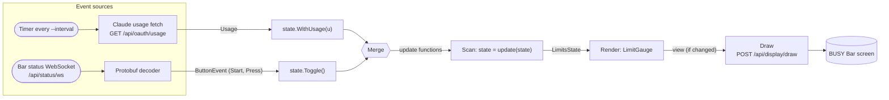

The generic machinery (`Poller`, `DisplayWatch`, `IDisplay<TView>`) is in **Busynet.Core** and knows nothing about
Claude or the bar. The feature (`ClaudeLimitsWatch`) only supplies the sources, the state type, the reducer functions
and the render function.

---

## 2. Projects and dependencies

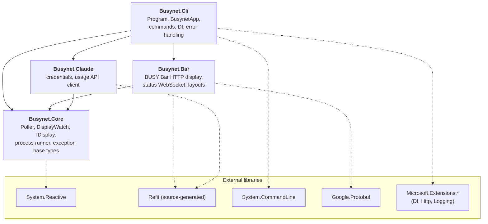

| Project | Responsibility | Key types |
| --- | --- | --- |
| `Busynet.Core` | Generic watch loop, polling, retry classification, child processes | `DisplayWatch`, `Poller`, `IDisplay<T>`, `ITransientFailure`, `BusynetException`, `ProcessRunner` |
| `Busynet.Bar` | Talking to the BUSY Bar: drawing, clearing, button events | `IBarFactory`, `IBarDisplay`, `ButtonEventStream`, `StatusSocket`, `LimitsLayout` |
| `Busynet.Claude` | Reading the Claude Code token and fetching usage | `IClaudeUsage`, `ClaudeUsageClient`, `ClaudeTokenSource` |
| `Busynet.Cli` | Command line, DI wiring, the `claude limits` feature, exit codes | `BusynetApp`, `ClaudeLimitsCommand`, `ClaudeLimitsWatch`, `LimitsState`, `ErrorHandler` |

---

## 3. The event pipeline

This is the core of the app. It is assembled in
[`ClaudeLimitsWatch.RunAsync`](../src/Busynet.Cli/Features/ClaudeLimits/ClaudeLimitsWatch.cs) and run by
[`DisplayWatch.RunAsync`](../src/Busynet.Core/Watching/DisplayWatch.cs).

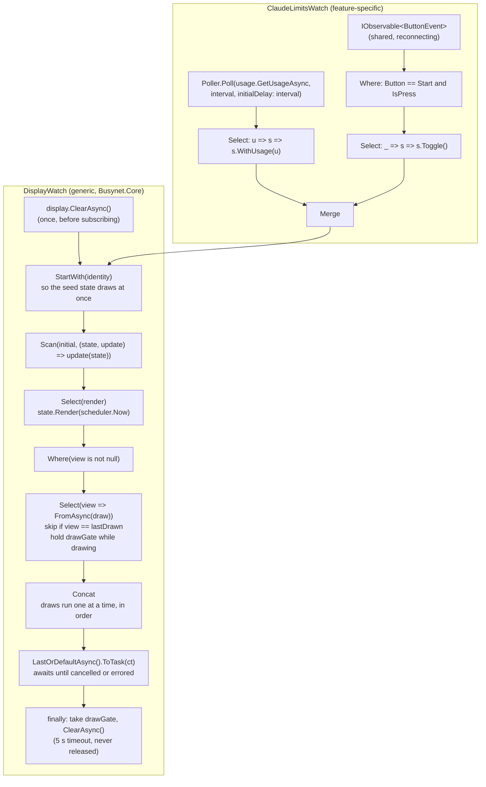

Things to know about the pipeline:

- **The seed fetch is outside the pipeline.** `ClaudeLimitsCommand` fetches usage once *before* the watch starts.
  If that first fetch fails (even transiently), the command exits 1 without touching the bar. That is why the poller's
  `initialDelay` equals `interval`: the first in-pipeline fetch is one interval after the seed.
- **Events become functions.** Both sources map to `Func<LimitsState, LimitsState>`, so `Merge` can combine
  sources of different types, and `Scan` needs only one reducer: "apply the function".
- **A toggle never fetches.** It re-renders from the last fetched `Usage`. It neither shortens nor restarts the
  poller's wait.
- **Render reads the clock.** `Render(scheduler.Now)` computes the countdown (`3h49m`) at render time, so the label
  changes on every poll even when the usage percentage does not.
- **Draws are deduplicated by value.** `LimitGauge` is a record, so `Equals` compares label, fill width and colour flag.
  Redrawing an identical view would restart animations on the device, so it is skipped. `lastDrawn` is updated only
  after a *successful* draw. A view whose draw failed is therefore retried on the next update.
- **`Concat` serialises draws.** Each `FromAsync` is cold, and `Concat` subscribes to the next one only after the
  previous one finishes, so two HTTP draws never overlap.
- **The stream never completes on its own.** Neither the poller nor the button stream completes. The watch ends only
  through cancellation (Ctrl+C), a fatal error from `updates` (for example `ClaudeAuthException`), or a non-transient
  draw failure.

### Poller internals

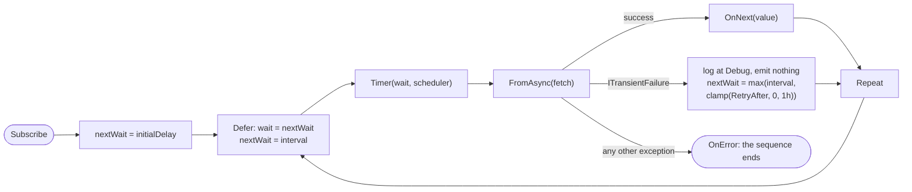

---

## 4. Class diagrams

### 4.1 Core: the generic watch machinery

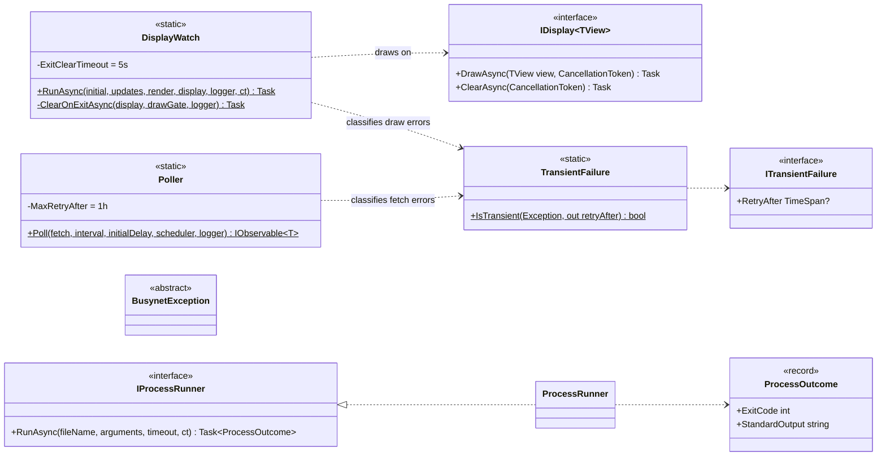

### 4.2 Bar: display and button events

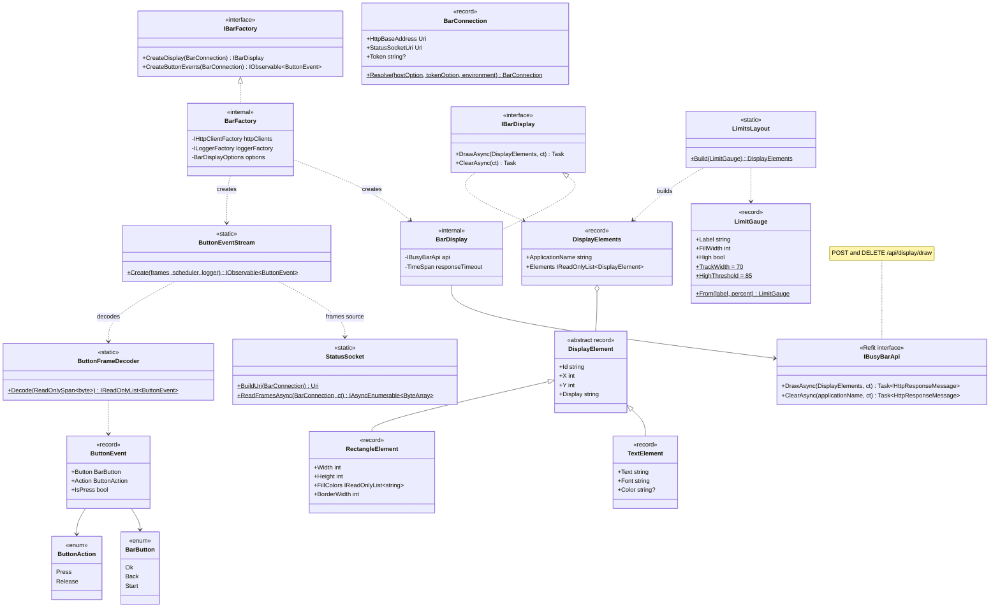

### 4.3 Claude: token and usage

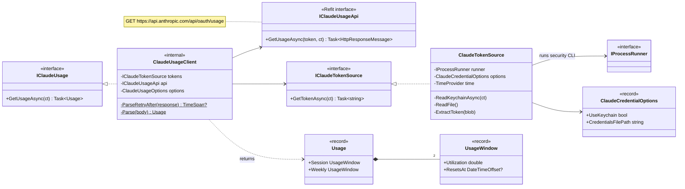

### 4.4 Cli: the `claude limits` feature

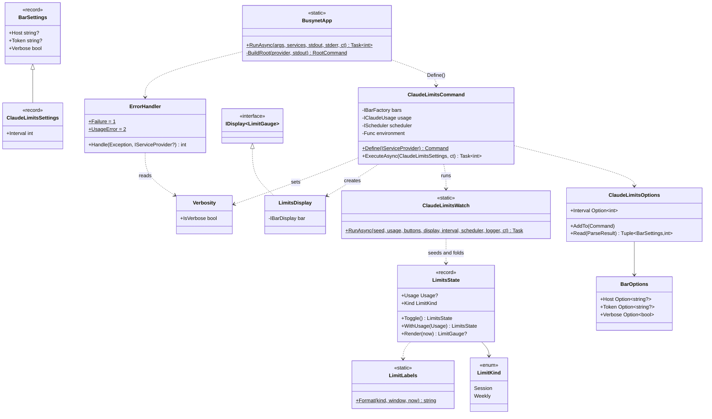

### 4.5 Exception hierarchy

The hierarchy carries two separate decisions:

- **`BusynetException`**: expected and user-facing. The CLI prints only the message.
- **`ITransientFailure`**: worth retrying. The watch survives it.

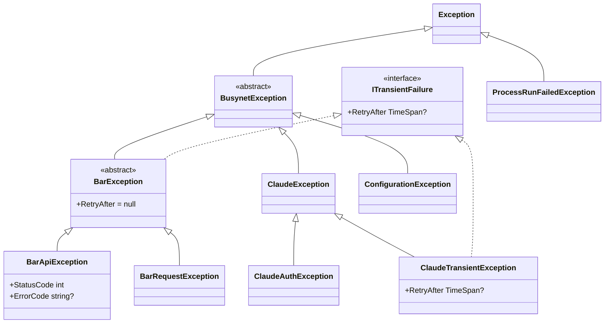

| Exception | Transient? | Effect while watching |
| --- | --- | --- |
| `BarApiException`, `BarRequestException` | yes | Draw is logged and skipped. The next update retries. |
| `ClaudeTransientException` (5xx, 429, network, bad body, keychain hiccup) | yes | Poll emits nothing. The next wait is `max(interval, Retry-After)`. |
| `ClaudeAuthException` (401/403, no or expired credentials) | no | Watch ends, bar is cleared, exit 1. |
| `ClaudeException` (other 4xx) | no | Watch ends, bar is cleared, exit 1. |
| `ConfigurationException` (bad `BUSYBOY_HOST` / `BUSYBOY_TOKEN`) | no | Thrown before the bar is touched, exit 1. |
| `ProcessRunFailedException` | n/a | Caught inside `ClaudeTokenSource` and turned into `ClaudeTransientException`. |

---

## 5. Sequence diagrams

### 5.1 Startup: from `Main` to the running watch

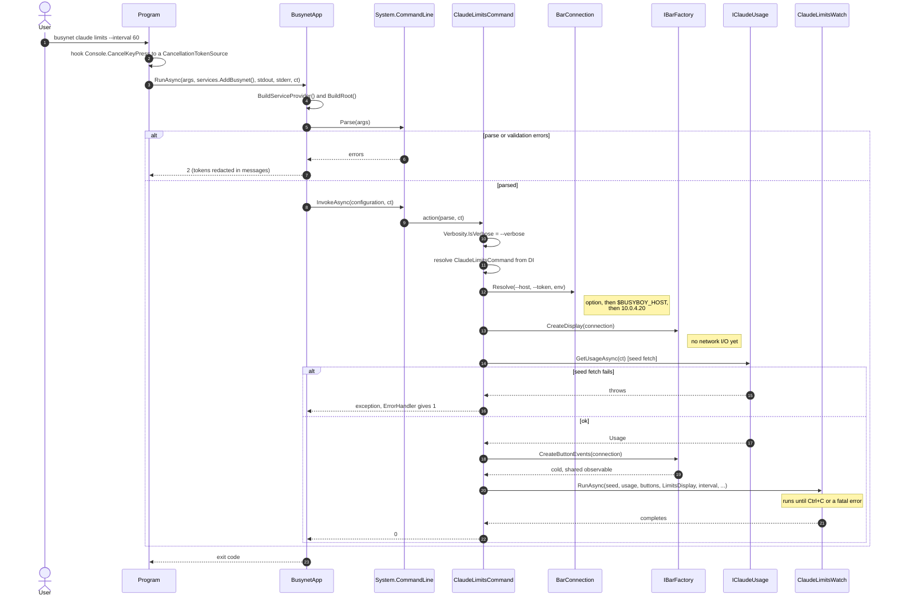

### 5.2 Watch start-up and the first draw

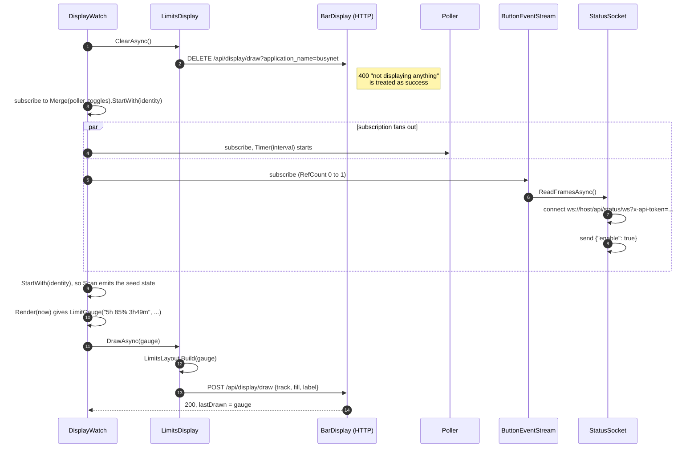

### 5.3 A poll cycle: success, transient failure, fatal failure

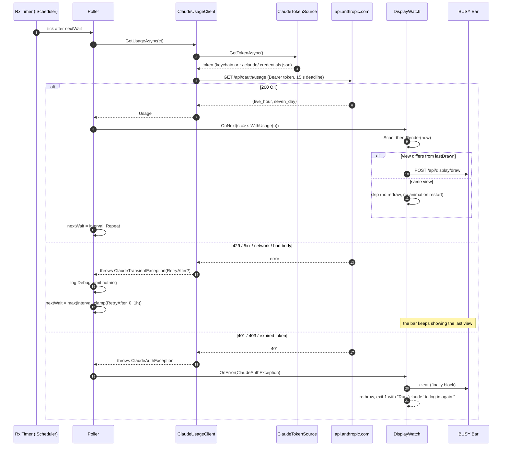

### 5.4 A Start-button press

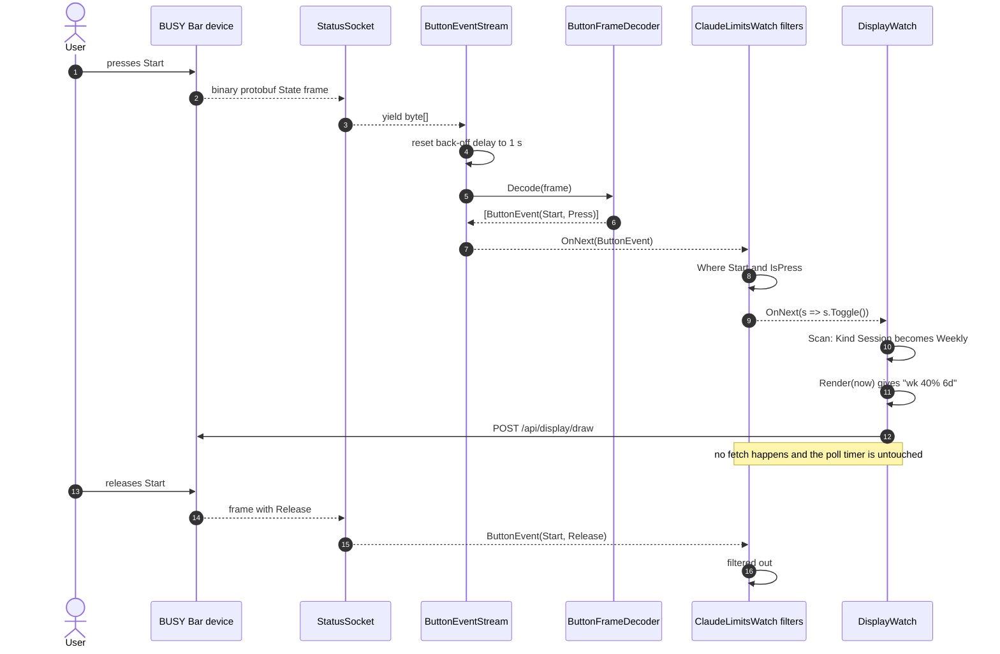

### 5.5 Ctrl+C shutdown and the draw gate

The draw gate (`SemaphoreSlim(1,1)`) keeps a draw from landing *after* the exit clear. Disposing the Rx subscription
cancels an in-flight draw's token but does not wait for it to finish.

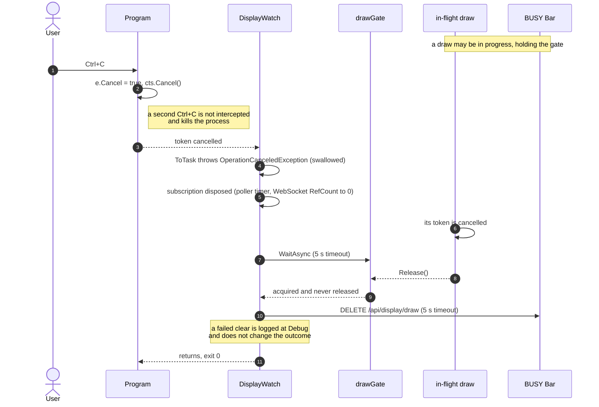

### 5.6 Reading the Claude Code token

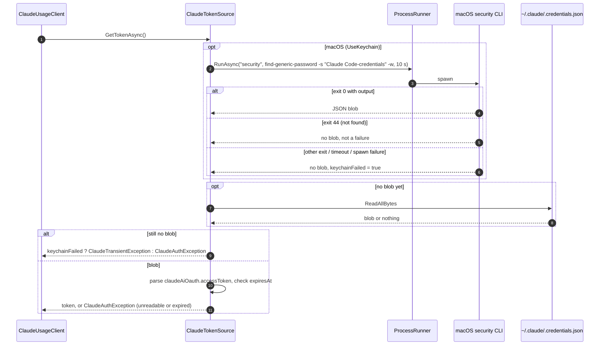

The token is read again on **every** fetch and is never cached. busynet never refreshes or writes it. When Claude Code
itself refreshes the token, the next poll picks up the new one.

---

## 6. State machines

### 6.1 `LimitsState`: what the bar shows

`LimitsState(Usage?, LimitKind)` is an immutable record. Updates return a copy (`with`).

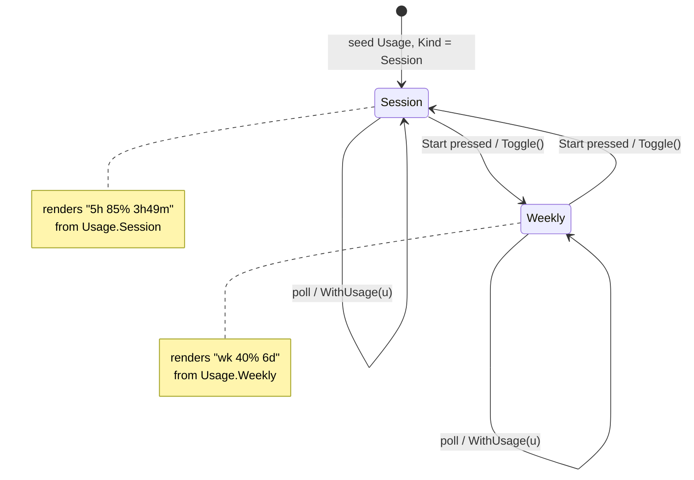

The gauge colour is a function of the rendered view: the track colour when `FillWidth == 0`, red when
`percent > 85`, coral otherwise.

### 6.2 `ButtonEventStream`: connection life cycle

The stream is lazy and shared (`Publish().RefCount()`). It never errors or completes: every failure becomes a
reconnect.

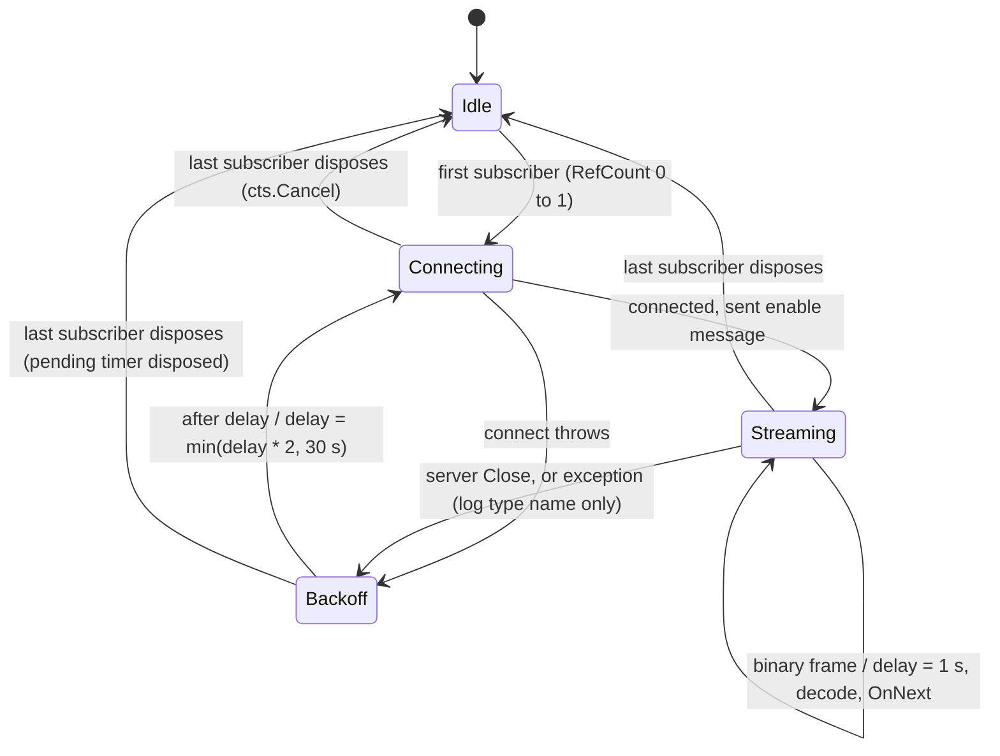

Liveness: the WebSocket sends keep-alive pings every 20 s with a 20 s timeout, so a connection that died silently
(Wi-Fi drop, laptop sleep) is noticed in about 40 s and reconnected.

---

## 7. Failures and exit codes

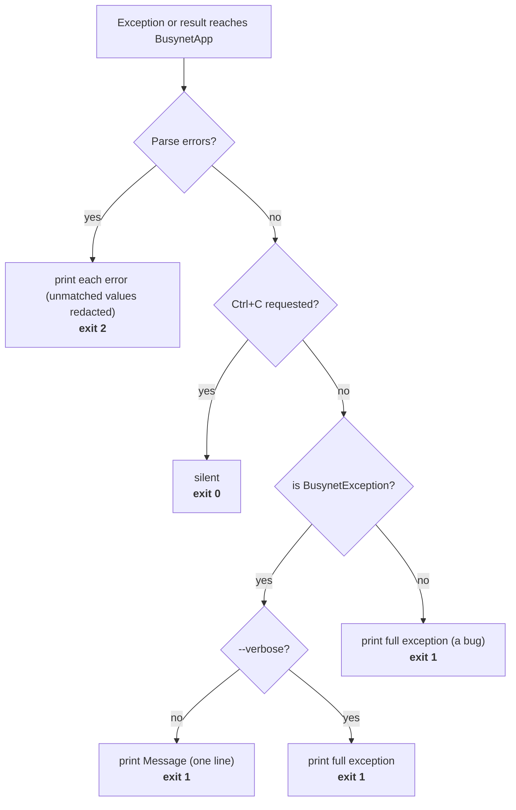

Ctrl+C is checked in two places. `ClaudeLimitsCommand.ExecuteAsync` returns 0 for *any* exception seen after
cancellation, because SIGINT also kills the child `security` process and that failure is fallout. `ErrorHandler`
returns 0 for an `OperationCanceledException` once the token is cancelled.

### Secret hygiene

Bar and Claude tokens appear in URLs, query strings and headers, so the code avoids every path that could print them:

- All `HttpClient` loggers are removed (`RemoveAllLoggers()`).
- Transport failures report the **exception type name only**: `BarRequestException`, `ClaudeTransientException`,
  and the WebSocket reconnect log.
- `BarConnection.ToString()` prints `Token = ***`.
- `ConfigurationException` names the variable but never its value, and keeps no inner exception.
- Parse-error messages have unmatched argument values replaced by `***`.

---

## 8. Concurrency notes

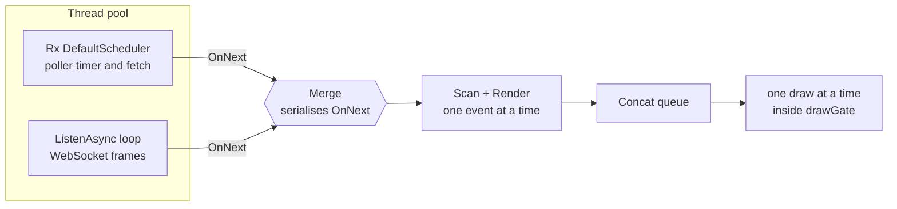

- **`Merge` serialises.** Rx guarantees that observers are not called concurrently, so `Scan` needs no lock even
  though poll results and button events arrive on different threads.
- **`Concat` queues draws.** If the bar is slow, later views wait their turn. Each draw re-checks `lastDrawn` when it
  starts, so a queued view equal to the one just drawn is skipped.
- **Fetches never overlap.** The poller's next `Timer` starts only after the previous fetch completes (`Repeat`
  re-subscribes on completion).
- **Time is injectable.** `IScheduler` comes from DI (`DefaultScheduler.Instance` in production). Tests pass a
  `TestScheduler` to drive the poller and the clock in `Render(scheduler.Now)` without waiting. The button stream's
  reconnect back-off also takes a scheduler parameter, but `BarFactory` always passes `DefaultScheduler.Instance`.
- **Verbosity is late-bound.** Loggers are created before `--verbose` is parsed. The log filter reads the
  `Verbosity` singleton at log time, and the command action sets it before resolving `ClaudeLimitsCommand`.

---

## 9. Adding a new watch command

The design lets a new "show X on the bar" command reuse the Core machinery.

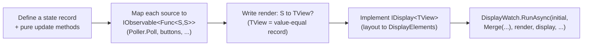

DisplayWatch then provides the initial clear, deduplicated and serialised draws, transient-failure tolerance,
cancellation, and the guaranteed clear on exit.
